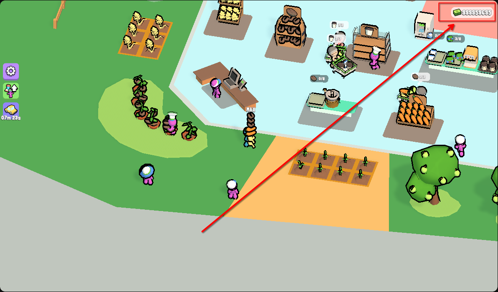

# My Mini Mart – Money Hack (YouTube Playables)

[Deutsch](README.md) · **English**



A small reverse-engineering project: how to find and set the money value of the
YouTube Playables game **My Mini Mart** in memory – on **Linux** with
[scanmem](https://github.com/scanmem/scanmem), on **Windows** with
[Cheat Engine](https://www.cheatengine.org/) and on **macOS** with
[Bit Slicer](https://github.com/zorgiepoo/Bit-Slicer).

> The game runs as WebAssembly (Unity) inside the browser. The money value lives
> in the WASM heap of a **Firefox content process** – not in the main Firefox
> process and not on a server.

---

## Game & links

| What | Link |
| --- | --- |
| This game | <https://www.youtube.com/playables/Ugkxto-OwJZo4rm8Xl2Nj3K403nHlYThf-sr> |
| YouTube Playables (hub) | <https://www.youtube.com/playables> |
| scanmem (Linux) | <https://github.com/scanmem/scanmem> |
| Cheat Engine (Windows) | <https://www.cheatengine.org/> |
| Bit Slicer (macOS) | <https://github.com/zorgiepoo/Bit-Slicer> |

---

## Result

From the tested session (Firefox, Linux):

| | |
| --- | --- |
| Process | Firefox content process (`-contentproc -isForBrowser …`) |
| Heap | `[anon:wasm-reserved]`, ~115 MB used of a 4 GB reservation |
| Money address | `0x7f19e896c2bc` |
| Heap offset | `0x4b7d2bc` (heap base `0x7f19e3def000`) |
| Freeze | `999999999` every 2 s |


---

## How it works

### 1. The browser is not the process you are looking for

Firefox puts every website into its own **content process**. The game
(Unity → WebAssembly) keeps its whole state in a large
`[anon:wasm-reserved]` block. That is where money is stored, as a 32-bit
integer.

Visible in `ps` as:

```
/usr/lib/firefox/firefox -contentproc -isForBrowser … -parentPid 7080 …
```

### 2. Why scanmem does not see the heap at first

By default scanmem only scans `heap`, `stack`, `exe` and `bss`. The WASM heap
has a **name** (`[anon:wasm-reserved]`) and is therefore skipped. So first:

```
option region_scan_level 3
reset
lregions
```

Look for the line containing `[anon:wasm-reserved]` – you need the region ID in
front of it (e.g. `42`).

### 3. Scan only inside the WASM heap

```
option scan_data_type number
dregion !42
```

- `region_scan_level 3` → scan named/anonymous regions too
- `dregion !42` → delete all regions **except** 42 (`!` inverts the set)
- `scan_data_type number` → covers `i16/i32/i64/f32` at once

### 4. The real trick: use the change as a filter

A single scan for `383` returns thousands of hits (prices, counters, texture
data …). The filter is the **change**:

1. Scan for current money: `383` → 3629 candidates
2. Buy/sell in game → display jumps to `463`
3. Scan for `463` → **exactly 1 candidate left**

### 5. Proof that the address is correct

Wrote `777777` to the address as a test. After the next sale the game itself
showed `777900` – it had added `+123`. That proved it is the real money value
and not a random counter.

```
set 0=999999999      # set once
set 0=999999999/2    # re-set every 2 seconds (freeze)
```

> **Important:** never write to hundreds of candidates at once. A mass write
> test crashed the tab once. Filter down to one address first – then write.

---

## Usage

### Linux (scanmem)

**Install**

```bash
# Arch / CachyOS / Manjaro
sudo pacman -S scanmem

# Debian / Ubuntu / Mint
sudo apt install scanmem
```

**Allow ptrace** (once, until reboot):

```bash
sudo sh -c 'echo 0 > /proc/sys/kernel/yama/ptrace_scope'
```

**Quick start with the script**

```bash
git clone https://github.com/benjarogit/My-Mini-Mart---Hack.git
cd My-Mini-Mart---Hack
chmod +x linux/*.sh

# read current money in game, e.g. 383
./linux/money_hunt.sh --old 383 --new 463 --set 999999999 --freeze 2
```

The script scans `383`, waits while you buy/sell in game, you enter the new
value (`463`), then it sets the target value and keeps it frozen. Run without
arguments for an interactive flow.

**Manual**

```bash
./linux/find_game_process.sh     # PID + heap base
scanmem <PID>
```

Then inside the scanmem console:

```
option region_scan_level 3
reset
lregions                      # note the wasm-reserved region ID
option scan_data_type number
dregion !<ID>
383                           # current value
```

Change money in game, then:

```
463                           # new value
list                          # should be 1 hit
set 0=999999999/2             # set + freeze
```

Stop the freeze: `kill <scanmem-pid>` (printed on start).

### Windows (Cheat Engine)

Details: [`windows/README.md`](windows/README.md)

Short version:

1. Open the game in your browser, note the money (e.g. `383`).
2. Task Manager → Details → pick the **`firefox.exe` process with the highest
   memory usage** (that is the content process of the tab).
3. Cheat Engine → "Open Process" → select exactly that `firefox.exe`.
4. Value Type **4 Bytes**, First Scan: `383`.
5. Buy/sell in game (e.g. `463`) → **Next Scan**: `463`.
6. One address remains → double-click → change value, tick the freeze box.

If "4 Bytes" finds nothing, repeat with **8 Bytes**.

### macOS (Bit Slicer)

Details: [`macos/README.md`](macos/README.md)

Short version:

1. Open the game in your browser, note the money.
2. Start Bit Slicer, pick the Firefox process with the big WASM heap as target
   (Activity Monitor helps to match it).
3. Search: **4-byte integer**, `383` → Search.
4. Change money in game → `463` → Search.
5. Edit the remaining address or enable "Lock".

---

## Files

```
linux/find_game_process.sh   auto-detect process + WASM heap
linux/money_hunt.sh          two-scan hunt incl. set/freeze
windows/README.md            Cheat Engine guide (DE/EN)
macos/README.md              Bit Slicer guide (DE/EN)
docs/img/money.png           screenshot of the result
```

---

## Limits & notes

- **The address is not permanent:** after a reload/crash the tab gets a new
  process and usually a new heap offset. Repeat the procedure (about 1 minute).
- **int32 limit:** values above `2,147,483,647` overflow. `999999999` is safe.
- **Freeze writes periodically:** that is intended (the game constantly deducts
  expenses). Stop it with `kill`.
- **Client-side only:** nothing is sent to YouTube servers. The save lives
  locally (IndexedDB) and usually survives a reload.
- **No Cheat Engine on Linux:** Cheat Engine is Windows software and the Linux
  port is a lot of work. scanmem does the same job natively.

---

## Disclaimer

This repository is a **reverse-engineering learning project** for a free
single-player browser game. No servers are manipulated and no other players are
affected. Using it may violate YouTube's terms of service – use at your own
risk, no warranty.

## License

[MIT](LICENSE)
