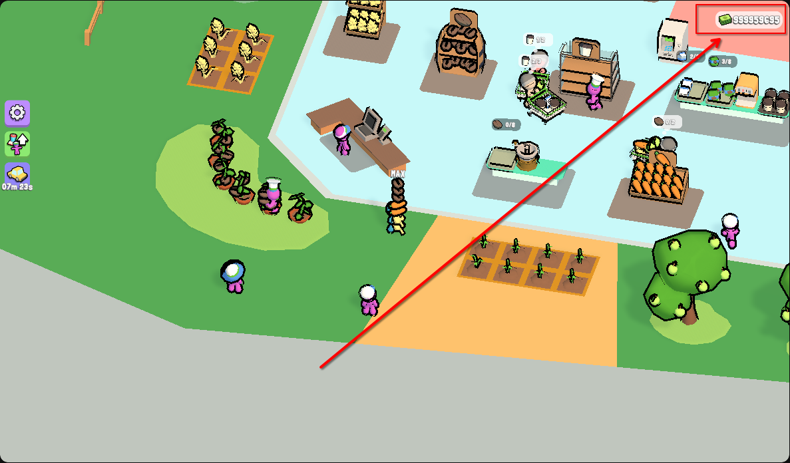

# My Mini Mart – Geld-Hack (YouTube Playables)

**Deutsch** · [English](README.en.md)



Ein kleines Reverse-Engineering-Projekt: Wie man im YouTube-Playables-Spiel
**My Mini Mart** den Geldwert im Arbeitsspeicher findet und beliebig hoch setzt –
unter **Linux** mit [scanmem](https://github.com/scanmem/scanmem), unter
**Windows** mit [Cheat Engine](https://www.cheatengine.org/) und unter
**macOS** mit [Bit Slicer](https://github.com/zorgiepoo/Bit-Slicer).

> Das Spiel läuft als WebAssembly (Unity) im Browser. Der Geldwert liegt im
> WASM-Heap eines **Firefox-Content-Processes** – nicht im Firefox-Hauptprozess
> und nicht auf einem Server.

---

## Spiel & Links

| Was | Link |
| --- | --- |
| Dieses Spiel | <https://www.youtube.com/playables/Ugkxto-OwJZo4rm8Xl2Nj3K403nHlYThf-sr> |
| YouTube Playables (Übersicht) | <https://www.youtube.com/playables> |
| scanmem (Linux) | <https://github.com/scanmem/scanmem> |
| Cheat Engine (Windows) | <https://www.cheatengine.org/> |
| Bit Slicer (macOS) | <https://github.com/zorgiepoo/Bit-Slicer> |

---

## Ergebnis

In der getesteten Sitzung (Firefox, Linux):

| | |
| --- | --- |
| Prozess | Firefox Content Process (`-contentproc -isForBrowser …`) |
| Heap | `[anon:wasm-reserved]`, ~115 MB belegt von 4 GB Reserve |
| Geld-Adresse | `0x7f19e896c2bc` |
| Offset im Heap | `0x4b7d2bc` (Heap-Basis `0x7f19e3def000`) |
| Freeze | `999999999` alle 2 s |


---

## Wie es funktioniert

### 1. Der Browser ist nicht der Prozess, den du suchst

Firefox lagert jede Webseite in einen eigenen **Content Process** aus. Das Spiel
(Unity → WebAssembly) legt seinen kompletten Spielzustand in einen großen
`[anon:wasm-reserved]`-Block. Genau dort steht das Geld als 32-Bit-Integer.

Im `ps`-Output erkennbar an:

```
/usr/lib/firefox/firefox -contentproc -isForBrowser … -parentPid 7080 …
```

### 2. Warum scanmem den Heap zuerst nicht sieht

scanmem scannt standardmäßig nur `heap`, `stack`, `exe` und `bss`. Der
WASM-Heap hat einen **Namen** (`[anon:wasm-reserved]`) und fällt dadurch aus dem
Raster. Deshalb zuerst:

```
option region_scan_level 3
reset
lregions
```

In der Regionsliste die Zeile mit `[anon:wasm-reserved]` suchen – die ID davor
(z. B. `42`) braucht man für den nächsten Schritt.

### 3. Nur im WASM-Heap suchen

```
option scan_data_type number
dregion !42
```

- `region_scan_level 3` → auch benannte/anonyme Regionen scannen
- `dregion !42` → alle Regionen **außer** 42 löschen (Set-Notation mit `!`)
- `scan_data_type number` → deckt `i16/i32/i64/f32` gleichzeitig ab

### 4. Der eigentliche Trick: Wertänderung als Filter

Ein einzelner Scan nach `383` liefert tausende Treffer (Preise, Zähler,
Texturwerte …). Der Filter ist die **Änderung**:

1. Scan nach dem aktuellen Geld: `383` → 3629 Kandidaten
2. Im Spiel kaufen/verkaufen → Anzeige springt auf `463`
3. Scan nach `463` → **genau 1 Kandidat** übrig

### 5. Beweis, dass die Adresse stimmt

Testweise `777777` auf die Adresse geschrieben. Nach der nächsten
Verkaufstransaktion stand dort **`777900`** – das Spiel selbst hat `+123`
addiert. Damit war klar: Das ist der echte Geldwert und nicht nur ein
zufälliger Zähler.

```
set 0=999999999      # einmalig setzen
set 0=999999999/2    # alle 2 Sekunden neu setzen (Freeze)
```

> **Wichtig:** Nicht massenhaft Kandidaten beschreiben. Ein Schreibtest auf
> hunderte Adressen gleichzeitig hat den Tab zum Absturz gebracht. Erst
> filtern, bis eine Adresse übrig ist – dann schreiben.

---

## Anleitung

### Linux (scanmem)

**Installieren**

```bash
# Arch / CachyOS / Manjaro
sudo pacman -S scanmem

# Debian / Ubuntu / Mint
sudo apt install scanmem
```

**ptrace erlauben** (einmalig, bis zum Neustart):

```bash
sudo sh -c 'echo 0 > /proc/sys/kernel/yama/ptrace_scope'
```

**Schnellweg mit Skript**

```bash
git clone https://github.com/benjarogit/My-Mini-Mart---Hack.git
cd My-Mini-Mart---Hack
chmod +x linux/*.sh

# aktuellen Wert im Spiel ablesen, z. B. 383
./linux/money_hunt.sh --old 383 --new 463 --set 999999999 --freeze 2
```

Das Skript scannt `383`, wartet, bis du im Spiel etwas kaufst/verkaufst, du
gibst den neuen Wert ein (`463`), und es setzt anschließend den Zielwert und
hält ihn fest. Ohne Argumente läuft es interaktiv.

**Manuell**

```bash
./linux/find_game_process.sh     # PID + Heap-Basis
scanmem <PID>
```

Dann in der scanmem-Konsole:

```
option region_scan_level 3
reset
lregions                      # ID der wasm-reserved-Region merken
option scan_data_type number
dregion !<ID>
383                           # aktueller Wert
```

Geld im Spiel ändern, dann:

```
463                           # neuer Wert
list                          # sollte 1 Treffer sein
set 0=999999999/2             # setzen + freezen
```

Freeze beenden: `kill <scanmem-PID>` (wird beim Start angezeigt).

### Windows (Cheat Engine)

Details: [`windows/README.md`](windows/README.md)

Kurzfassung:

1. Spiel im Browser öffnen, Geldstand notieren (z. B. `383`).
2. Task-Manager → Details → **den `firefox.exe`-Prozess mit dem größten
   Arbeitsspeicher** nehmen (das ist der Content-Process des Tabs).
3. Cheat Engine → „Open Process" → genau diesen `firefox.exe` wählen.
4. Value Type **4 Bytes**, First Scan: `383`.
5. Im Spiel kaufen/verkaufen (z. B. `463`) → **Next Scan**: `463`.
6. Übrig bleibt eine Adresse → Doppelklick → Wert ändern, Häkchen für Freeze.

Falls „4 Bytes" nichts findet: mit **8 Bytes** wiederholen.

### macOS (Bit Slicer)

Details: [`macos/README.md`](macos/README.md)

Kurzfassung:

1. Spiel im Browser öffnen, Geldstand notieren.
2. Bit Slicer starten, als Target den Firefox-Prozess mit dem großen
   WASM-Heap wählen (Aktivitätsanzeige hilft beim Zuordnen).
3. Suche: **4-Byte Integer**, `383` → Search.
4. Im Spiel Geld ändern → `463` → Search.
5. Verbleibende Adresse editieren oder „Lock" aktivieren.

---

## Dateien

```
linux/find_game_process.sh   Prozess + WASM-Heap automatisch finden
linux/money_hunt.sh          Zwei-Scan-Hunt inkl. Setzen/Freeze
windows/README.md            Cheat-Engine-Anleitung (DE/EN)
macos/README.md              Bit-Slicer-Anleitung (DE/EN)
docs/img/money.png           Screenshot des Ergebnisses
```

---

## Grenzen & Hinweise

- **Adresse ist nicht dauerhaft:** Nach einem Reload/Absturz bekommt der Tab
  einen neuen Prozess und meist auch einen neuen Heap-Offset. Dann die Prozedur
  wiederholen (dauert ~1 Minute).
- **int32-Grenze:** Werte über `2.147.483.647` laufen über. `999999999` ist ein
  sicherer Wert.
- **Freeze schreibt periodisch:** Das ist gewollt (das Spiel zieht laufend
  Ausgaben ab). Beenden mit `kill`.
- **Rein clientseitig:** Es wird nichts an YouTube-Server geschickt. Der
  Spielstand liegt lokal (IndexedDB) und bleibt nach einem Reload meist
  erhalten.
- **Kein Cheat Engine auf Linux:** Cheat Engine ist Windows-Software; der
  Linux-Port ist aufwendig. scanmem macht denselben Job nativ.

---

## Disclaimer

Dieses Repository ist ein **Reverse-Engineering-Lernprojekt** für ein
kostenloses Einzelspieler-Browserspiel. Es werden keine Server manipuliert und
keine anderen Spieler beeinflusst. Die Nutzung kann gegen die Nutzungsbedingungen
von YouTube verstoßen – Benutzung auf eigene Gefahr, ohne Gewähr.

## Lizenz

[MIT](LICENSE)
