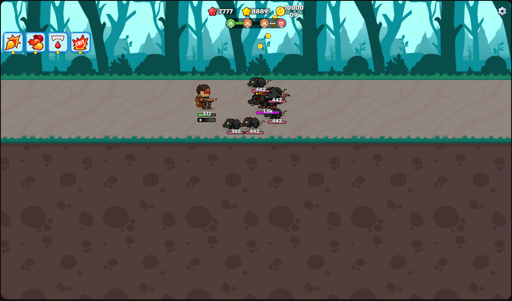

# Claw Master

**Münzen, gelbe & rote Sterne auf Maximum** · ⏱ ca. 1 Minute

[← Alle Spiele](../README.md) · **Deutsch** · [English](#english)

[](../docs/img/claw-master.png)

*Screenshot: das Ergebnis im Spiel – klicken zum Vergrößern*

**Spiel:** <https://www.youtube.com/playables/UgkxpLqVBYvac8lZ3ZJRIZG2KoKsj56nyq09>

---

## Deutsch

### In 1 Minute

1. **Spiel öffnen** – Link oben anklicken und warten, bis der Spielstand
   sichtbar ist (Münzen und Sterne oben im Bild).
2. **Skript starten** – Terminal im Repo-Ordner öffnen und eingeben:

   ```bash
   sudo python3 linux/claw_master_set.py --easy
   ```

   Das Skript sucht den Spielstand selbst. Du musst **nichts** ablesen oder
   eintippen.
3. **Kurz weiterspielen** – einen Gegner besiegen oder ein Level beenden.
   Erst dann zeichnet das Spiel die neuen Werte.

Fertig: **99.999 Münzen**, **8.888 gelbe** und **7.777 rote Sterne**.

> 💡 **Warum weiterspielen?** Claw Master zeichnet das HUD nur bei einem
> Spielevent neu. Der Speicher ist sofort geändert, die Anzeige hinkt nur
> hinterher.

### Was du brauchst

- Linux mit **scanmem** (einmalig installieren, siehe
  [Hauptseite](../README.md#3-dein-betriebssystem))
- Den Spiel-Tab offen und fertig geladen
- Windows oder macOS? → [Cheat Engine](../windows/README.md) bzw.
  [Bit Slicer](../macos/README.md)

### Eigene Werte setzen

Statt `--easy` kannst du jeden Wert selbst wählen:

```bash
sudo python3 linux/claw_master_set.py \
  --new-coins 99999 --new-yellow 8888 --new-red 7777
```

Nur einen Wert ändern? Dann die anderen Flags einfach weglassen. Mit
`--show` listet das Skript nur auf, was es gefunden hat, und schreibt nichts.

### Wenn's nicht klappt

| Problem | Lösung |
| :--- | :--- |
| `error: no Claw Master currency record found` | Der Spiel-Tab ist nicht (fertig) geladen. Tab neu laden, kurz warten, Skript erneut starten. |
| „no Firefox content process“ | Firefox läuft nicht oder das Spiel ist in einem anderen Browser offen. Das Skript braucht **Firefox**. |
| Anzeige bleibt alt | Ein Spielevent auslösen (Gegner besiegen, Level beenden). |
| Münzanzeige zeigt zwei Blöcke | Normal ab 6 Stellen: `1000009` wird als `10000` + `09` gezeichnet. Der Wert stimmt – für eine saubere Anzeige `99999` nehmen. |
| Nach einem Reload ist alles weg | Die Adresse ändert sich. Skript einfach noch einmal ausführen. |

<details>
<summary><b>So funktioniert's (Technik)</b></summary>

Alle drei Werte liegen in **einem** 0x60-Byte-Datensatz im WASM-Heap:

```
record + 0x00   Münzen
record + 0x18   gelbe Sterne
record + 0x30   rote Sterne
```

Das Spiel hält diesen Datensatz in **mehreren identischen Kopien** (beim Test:
vier, davon zwei mit dem aktiven Spielstand). Deshalb schreibt das Skript immer
**alle Kopien gleichzeitig** – sonst überschreibt eine alte Kopie die neuen
Werte.

Gefunden wurde der Datensatz über die Werte selbst:

1. HUD am Anfang: **0 rot / 1 gelb / 20 Münzen**.
2. Gespielt → **0 / 2 / 60**, nochmal gespielt → **0 / 3 / 80**.
3. Filter über die Münzen (`60 → 80`) ließ 8 Adressen übrig. Vier davon hatten
   bei `+0x18` den gelben Stern-Wert `3` – das ist der Datensatz.
4. Testschreibung `8888`: nach dem nächsten Gegner-Kill zeigte das HUD `8918`
   (8888 + 30 verdient) → Adresse bestätigt.
5. Der rote Stern ging in der Testrunde von `0` auf `1` und sitzt bei `+0x30`.

Damit das Skript ohne HUD-Werte funktioniert, sucht es nach einem konstanten
Zahlenpaar im Datensatz (`236588110, -1` bei `Münzen + 0x08`) und nimmt die
Gruppe mit den meisten Münzen – das ist der aktive Spielstand.

</details>

<details>
<summary><b>Selbst scannen mit scanmem</b></summary>

```
option region_scan_level 3
reset
lregions                  # ID der wasm-reserved-Zeile merken (z. B. 42)
option scan_data_type number
dregion !42
80                        # aktueller Münzstand
```

Münzen im Spiel ändern, neuen Wert scannen, wiederholen. Die Treffer, bei denen
`+0x18` der gelbe Stern-Wert ist, gehören zum Datensatz – alle gleichzeitig
setzen:

```
set 0,1=99999             # Münzen in beiden Kopien
```

</details>

### Windows / macOS

Gleiches Vorgehen mit Cheat Engine bzw. Bit Slicer: **4 Bytes**, Münzstand
scannen, im Spiel ändern, neu filtern. Die Sterne liegen im gleichen Datensatz
(`+0x18` gelb, `+0x30` rot) – in der Adressliste die Nachbar-Adressen prüfen
und alle Kopien gleichzeitig ändern.

---

## English

### In 1 minute

1. **Open the game** – click the link above and wait until the HUD is visible.
2. **Run the script** – open a terminal in the repo folder:

   ```bash
   sudo python3 linux/claw_master_set.py --easy
   ```

   The script finds the save data by itself. Nothing to read or type.
3. **Keep playing** – defeat an enemy or finish a level so the HUD redraws.

Done: **99,999 coins**, **8,888 yellow** and **7,777 red stars**.

> 💡 Claw Master only redraws the HUD on an in-game event. Memory is changed
> immediately, the display just lags behind.

### What you need

- Linux with **scanmem** (install once, see
  [main page](../README.en.md#3-your-operating-system))
- The game tab open and fully loaded
- On Windows or macOS? → [Cheat Engine](../windows/README.md) or
  [Bit Slicer](../macos/README.md)

### Custom values

Instead of `--easy`, pick your own values:

```bash
sudo python3 linux/claw_master_set.py \
  --new-coins 99999 --new-yellow 8888 --new-red 7777
```

Change just one value by leaving out the other flags. `--show` only lists what
it finds and writes nothing.

### If it doesn't work

| Problem | Fix |
| :--- | :--- |
| `error: no Claw Master currency record found` | The game tab isn't loaded (yet). Reload it, wait a moment, run the script again. |
| "no Firefox content process" | Firefox isn't running, or the game is open in another browser. The script needs **Firefox**. |
| Display stays old | Trigger an in-game event (defeat an enemy, finish a level). |
| Coin display shows two blocks | Normal from 6 digits on: `1000009` is drawn as `10000` + `09`. The value is correct – use `99999` for a clean display. |
| Everything is gone after a reload | The address changes. Just run the script again. |

<details>
<summary><b>How it works (technical)</b></summary>

All three values live in **one** 0x60-byte record in the WASM heap:

```
record + 0x00   coins
record + 0x18   yellow stars
record + 0x30   red stars
```

The game keeps that record in **several identical copies** (four in the test,
two of them holding the active save). The script therefore writes **all copies
at once** – otherwise a stale copy overwrites the new values.

The record was found through the values themselves:

1. HUD at the start: **0 red / 1 yellow / 20 coins**.
2. Played → **0 / 2 / 60**, played again → **0 / 3 / 80**.
3. Filtering on the coins (`60 → 80`) left 8 addresses. Four of them had the
   yellow star value `3` at `+0x18` – that is the record.
4. Test write of `8888`: after the next enemy kill the HUD showed `8918`
   (8888 + 30 earned) → address confirmed.
5. The red star went from `0` to `1` during the test round and sits at `+0x30`.

To work without HUD values, the script searches for a constant number pair in
the record (`236588110, -1` at `coins + 0x08`) and takes the group with the most
coins – the active save.

</details>

<details>
<summary><b>Manual scanmem flow</b></summary>

```
option region_scan_level 3
reset
lregions                  # note the wasm-reserved region ID (e.g. 42)
option scan_data_type number
dregion !42
80                        # current coins
```

Change the coins in game, scan the new value, repeat. Hits where `+0x18` equals
the yellow star count belong to the record – write all of them:

```
set 0,1=99999             # coins in both copies
```

</details>

### Windows / macOS

Same approach with Cheat Engine or Bit Slicer: **4 bytes**, scan the coin count,
change it in game, filter again. The stars live in the same record (`+0x18`
yellow, `+0x30` red) – check the neighbouring addresses in the address list and
change every copy at once.
