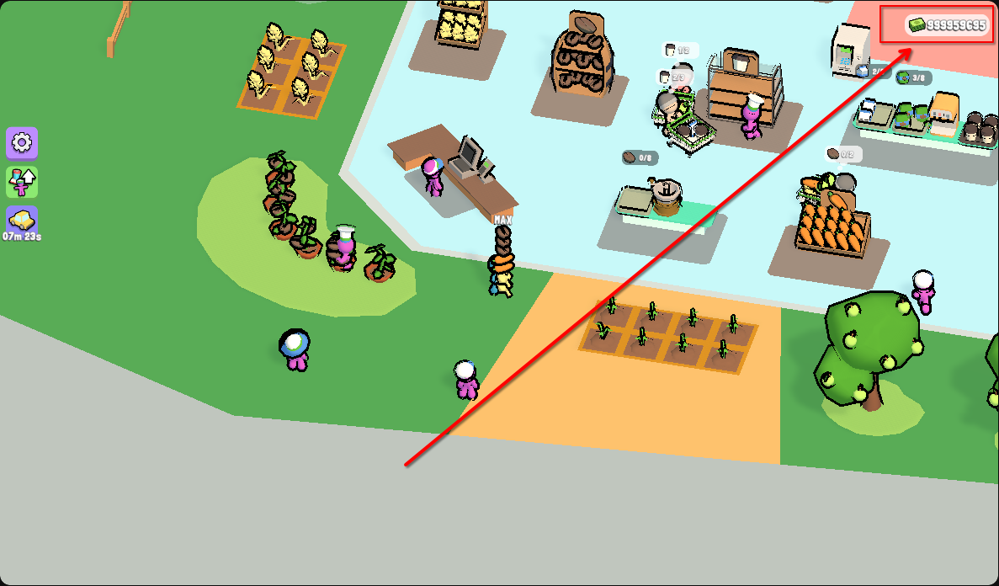

# My Mini Mart – Geld

[← Alle Spiele](../README.md) · **Deutsch** · [English](#english)

[](../docs/img/my-mini-mart.png)

*Klicken zum Vergrößern / click to enlarge*

**Spiel:** <https://www.youtube.com/playables/Ugkxto-OwJZo4rm8Xl2Nj3K403nHlYThf-sr>

---

## Deutsch

### Gefundene Werte

| | |
| --- | --- |
| Prozess | Firefox Content Process (`-contentproc -isForBrowser …`) |
| Heap | `[anon:wasm-reserved]`, ~115 MB belegt |
| Heap-Basis | `0x7f19e3def000` |
| Geld-Adresse | `0x7f19e896c2bc` |
| Offset im Heap | `0x4b7d2bc` |
| Freeze | `999999999` alle 2 s |

### Fundweg

1. Scan nach `383` (aktueller Geldstand) im WASM-Heap → 3629 Kandidaten.
2. Im Spiel verkauft, Anzeige springt auf `463`.
3. Scan nach `463` → **genau 1 Kandidat**.
4. Test: `777777` auf die Adresse geschrieben. Nach der nächsten
   Verkaufstransaktion stand dort `777900` – das Spiel hatte selbst `+123`
   addiert. Damit war die Adresse bestätigt.

### Besonderheiten

- Die Anzeige folgt der Adresse **sofort** (jedes Frame).
- Das Spiel zieht laufend Ausgaben ab (ca. 450/Sek.), deshalb ist ein Freeze
  sinnvoll.
- Nach einem Reload ändert sich der Offset – Prozedur wiederholen.

### Setzen

```
set 0=999999999      # einmalig
set 0=999999999/2    # Freeze alle 2 Sekunden
```

---

## English

### Values found

| | |
| --- | --- |
| Process | Firefox content process (`-contentproc -isForBrowser …`) |
| Heap | `[anon:wasm-reserved]`, ~115 MB used |
| Heap base | `0x7f19e3def000` |
| Money address | `0x7f19e896c2bc` |
| Heap offset | `0x4b7d2bc` |
| Freeze | `999999999` every 2 s |

### How it was found

1. Scan for `383` (current money) in the WASM heap → 3629 candidates.
2. Sold something in game, the display jumped to `463`.
3. Scan for `463` → **exactly 1 candidate**.
4. Test: wrote `777777` to the address. After the next sale it read `777900` –
   the game itself added `+123`. Address confirmed.

### Notes

- The display follows the address **immediately** (every frame).
- The game constantly deducts expenses (~450/s), so a freeze makes sense.
- After a reload the offset changes – repeat the procedure.

### Set

```
set 0=999999999      # once
set 0=999999999/2    # freeze every 2 seconds
```
