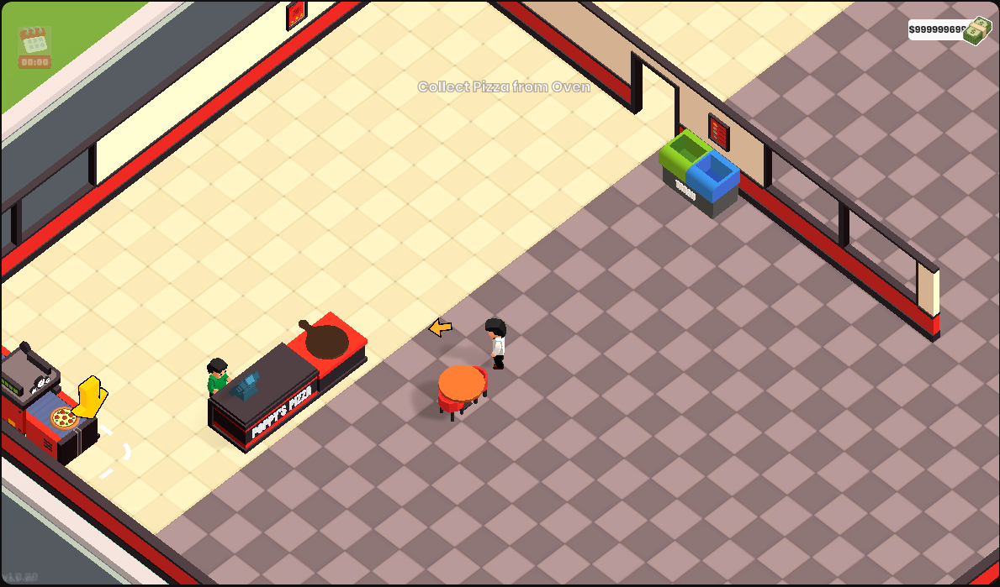

# Pizza Inc. – Geld

[← Alle Spiele](../README.md) · **Deutsch** · [English](#english)

[](../docs/img/pizza-inc.png)

*Klicken zum Vergrößern / click to enlarge*

**Spiel:** <https://www.youtube.com/playables/UgkxOTqK6a2_6ChV0IEN39C8HVRNNaDNa_St>

---

## Deutsch

### Gefundene Werte

| | |
| --- | --- |
| Prozess | Firefox Content Process (`-contentproc -isForBrowser …`) |
| Heap | `[anon:wasm-reserved]`, ~166 MB belegt |
| Heap-Basis | `0x7f19e0def000` |
| Geld-Adressen | `0x7f19e24f9e7c`<br>`0x7f19e2fc074c`<br>`0x7f19e2fc0cbc`<br>`0x7f19e3715f10` |

### Fundweg

1. Scan nach `750` (aktueller Geldstand) im WASM-Heap → 464 Kandidaten.
2. Im Spiel etwas gekauft, Anzeige springt auf `650`.
3. Scan nach `650` → **4 Kandidaten**.
4. Noch eine Transaktion, Anzeige `550` → **alle 4 Kandidaten** waren ebenfalls
   auf `550`. Das Spiel hält den Geldwert also in vier Kopien.

### Besonderheiten

- **Die Anzeige aktualisiert nur bei einer echten Transaktion.** Ein direkter
  Schreibvorgang auf die Adressen ändert den Speicher, aber erst der nächste
  Kauf/Verkauf zeigt den neuen Wert an.
- Deshalb beim Setzen **alle vier Adressen** gleichzeitig beschreiben, sonst
  überschreibt das Spiel die geänderten Kopien wieder mit dem alten Wert.
- Nach einem Reload ändert sich der Offset – Prozedur wiederholen.

### Setzen

```
set 0,1,2,3=999999999      # einmalig, alle vier Kopien
set 0,1,2,3=999999999/2    # Freeze alle 2 Sekunden
```

---

## English

### Values found

| | |
| --- | --- |
| Process | Firefox content process (`-contentproc -isForBrowser …`) |
| Heap | `[anon:wasm-reserved]`, ~166 MB used |
| Heap base | `0x7f19e0def000` |
| Money addresses | `0x7f19e24f9e7c`<br>`0x7f19e2fc074c`<br>`0x7f19e2fc0cbc`<br>`0x7f19e3715f10` |

### How it was found

1. Scan for `750` (current money) in the WASM heap → 464 candidates.
2. Bought something in game, the display jumped to `650`.
3. Scan for `650` → **4 candidates**.
4. Another transaction, display `550` → **all 4 candidates** were `550` too.
   The game keeps the money value in four copies.

### Notes

- **The HUD only updates on a real transaction.** Writing to the addresses
  changes memory, but the new value is only shown after the next buy/sell.
- Therefore write to **all four addresses** at once, otherwise the game
  overwrites the changed copies with the old value.
- After a reload the offset changes – repeat the procedure.

### Set

```
set 0,1,2,3=999999999      # once, all four copies
set 0,1,2,3=999999999/2    # freeze every 2 seconds
```
